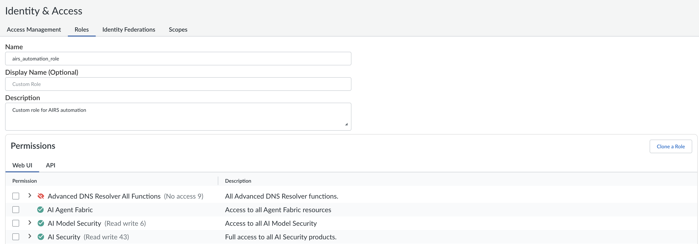
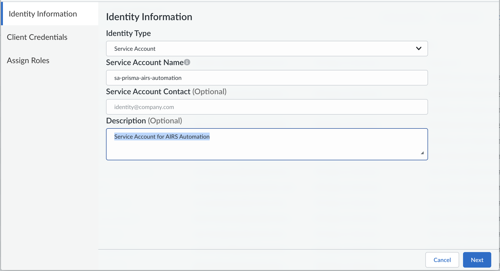
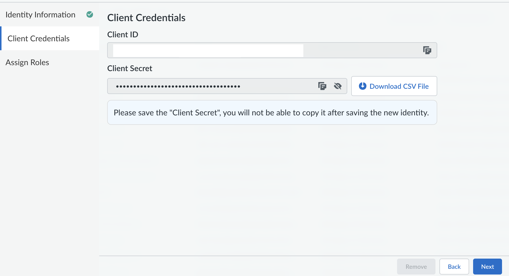
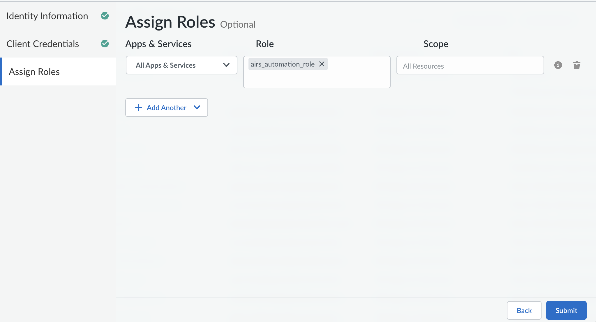
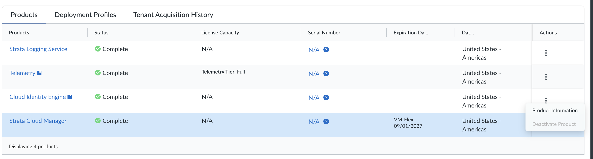
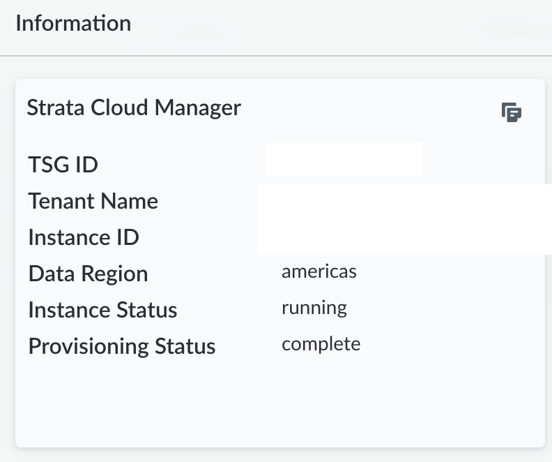
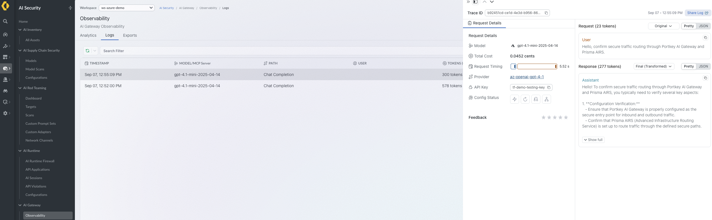

# 01. Prisma AIRS - AI Gateway Integration Guide

## Introduction

The **Prisma AIRS AI Gateway** provides a centralized security, governance, and observability layer for all AI traffic in your organization — including LLM prompts, Model Context Protocol (MCP) interactions, and agent-to-agent (A2A) communication. 

Managed through **Palo Alto Networks Strata Cloud Manager (SCM)**, it supports two deployment models:

* **SaaS** — Enabled by default. No additional infrastructure setup required. Scales automatically with built-in high availability. **(This is the deployment model used in this guide)**.
* **Hybrid** — Hosts the Data Plane in your own environment using containerized deployments (Helm charts on Kubernetes), managed centrally via SCM for maximum resiliency and data residency control.

> 📘 **Official Documentation Reference:**  
> [Palo Alto Networks - Configure AI Gateway Administration Guide](https://docs.paloaltonetworks.com/ai-runtime-security/administration/configure-ai-gateway)

---

## Step-by-Step AI Gateway Deployment & Integration with Azure OpenAI

### 1. Licensing and Activation

AI Gateway is licensed using **Palo Alto Networks Flex Credits**. All metering is based on real-time token consumption across prompts, responses, tool calls, and agent interactions.

* **Token Metering Baseline:** $1 \text{ token} \approx 4 \text{ characters}$ of text (industry standard).
* **Sizing:** License your instance based on the maximum expected monthly token throughput.

#### Activation Steps

* Create a **Deployment Profile (DP)** in Strata Cloud Manager (SCM) and allocate Flex Credits to AI Gateway.
* Indicate preferred deployment mode (*SaaS* or *Hybrid*) — tracking purpose only, not enforced.
* Map the Deployment Profile to a **Tenant Service Group (TSG)** to link SCM and the Licensing System (SLS) to AI Gateway.  
  > ⚠️ The Tenant Service Group (TSG) **MUST be located in the Americas Region**.
* Launch SCM to complete setup and configuration.

---

### 2. SaaS Onboarding

The SaaS Gateway is enabled by default. After licensing activation, you can start routing AI traffic through the gateway immediately — no infrastructure work required.

### 3. Service Account and Role Setup in SCM

To automate the creation of Workspaces, Virtual Keys, Providers,... via APIs, you must create a dedicated Service Account in Strata Cloud Manager (SCM).

#### Step 1: Create the Custom Role

1. Access **Strata Cloud Manager** ([stratacloudmanager.paloaltonetworks.com](https://stratacloudmanager.paloaltonetworks.com/)).
2. Navigate to **System Settings** -> **Identity & Access Management** -> **Roles** -> **Custom Roles**.
3. Click **Add Role**, set **Name** to `airs_automation_role`, and **Description** to `Custom role for AIRS automation`.
4. In the permissions matrix, enable:
   * **AI Security**
   * **AI Model Security**
   * **AI Agent Fabric**  
   <p align="center">
   
   </p>
   *(Note: These global options are enabled so this same service account can be reused across all other modules in this repository. If you prefer a strictly restricted approach, you can limit the scope exclusively to AI Runtime Security / Gateway Management capabilities).*
5. Click **Save** to store the role definition within your Tenant Service Group (TSG).

#### Step 2: Provision the Service Account

1. Under **System Settings** -> **Identity & Access Management** ->  **Access Management** select **Add Identity**.
2. Identity Type **Service Account**, set the Service Account Name to **sa-prisma-airs-automation** and Description (optional) **Service Account for AIRS Automation** and click **Next**
   <p align="center">
   
   </p>
3. Copy and save in a secure place the **Client ID** and **Client Secret** and click **Next**
   <p align="center">
   
   </p>
4. In Assign Roles select the custom role **airs_automation_role** and click Submit
   <p align="center">
   
   </p>

#### Step 3: Get the TSG ID

1. Access **Strata Cloud Manager** ([stratacloudmanager.paloaltonetworks.com](https://stratacloudmanager.paloaltonetworks.com/)).
2. Navigate to **System Settings** -> **Tenant** and select the AI GW Tenant and then go to Actions and select producto information:
   <p align="center">
   
   </p>
3. Copy the **TSG ID** in a secure place
   <p align="center">
   
   </p>

   ---

### Step 4: Local Environment Configuration (`terraform.tfvars`)

To adhere to security best practices and keep the configuration minimal, all non-sensitive operational parameters (such as workspace names, deployment names, API versions, and model aliases) are pre-configured with default values inside `variables.tf`.

The local `terraform.tfvars` file must contain **only** the required authentication secrets and API keys specific to your tenant environment.

> ⚠️ **Security Warning:** Never commit `terraform.tfvars` to version control. Ensure it is explicitly listed inside your `.gitignore`.

#### Step 1: Create the `terraform.tfvars` File

Create a file named `terraform.tfvars` inside the `01-AI-Gateway` directory:

```bash
touch terraform.tfvars
```

#### Step 2: Define Required Credentials

Populate terraform.tfvars with your Palo Alto Networks Service Account credentials, TSG ID, and Azure OpenAI API key:

# ==============================================================================
# Palo Alto Networks Strata Cloud Manager (SCM) Credentials
# ==============================================================================
panw_mgmt_client_id     = "YOUR_SERVICE_ACCOUNT_CLIENT_ID"
panw_mgmt_client_secret = "YOUR_SERVICE_ACCOUNT_CLIENT_SECRET"
panw_mgmt_tsg_id        = "YOUR_TENANT_SERVICE_GROUP_ID" # e.g., "1534850609"

# ==============================================================================
# Azure OpenAI Credentials
# ==============================================================================
azure_openai_api_key    = "YOUR_AZURE_OPENAI_API_KEY"

#### Variables Resolution & Lifecycle Summary

| Variable Name | Resolution Source | Value / Behavior | Sensitive |
| :--- | :--- | :--- | :---: |
| `panw_mgmt_client_id` | `terraform.tfvars` | Required (Service Account Client ID) | Yes |
| `panw_mgmt_client_secret` | `terraform.tfvars` | Required (Service Account Client Secret) | Yes |
| `panw_mgmt_tsg_id` | `terraform.tfvars` | Required (Tenant Service Group ID) | No |
| `azure_openai_api_key` | `terraform.tfvars` | Required (Azure Portal API Key) | Yes |
| `workspace_name` | `variables.tf` | Default: `ws-azure-demo` | No |
| `workspace_description` | `variables.tf` | Default: `Workspace for Azure OpenAI Governance & Security` | No |
| `azure_openai_deployment_name` | `variables.tf` | Default: `gpt-4.1-mini-demo` | No |
| `azure_openai_foundation_model` | `variables.tf` | Default: `gpt-4.1-mini-2025-04-14` | No |
| `azure_openai_model_alias` | `variables.tf` | Default: `azure-gpt4mini-demo` | No |
| `azure_openai_api_version` | `variables.tf` | Default: `2024-06-01` | No |
| `azure_openai_resource_name` | **Interactive CLI Prompt** | Prompted during `terraform apply` | No |


### Step 5. Automated Infrastructure Deployment (Terraform)

The Terraform configuration provisions the Control Plane resources using the local airs CLI wrapper and direct API calls.

#### Step 1: Initialize Terraform
Initialize the working directory and download required provider plugins:

```bash
terraform init
```

### Step 2: Review Execution Plan
Inspect the resources to be created:

```bash
terraform plan
```

### Step 3: Apply Configuration
Execute the deployment:

```bash
terraform apply
```

During the apply phase, Terraform will pause and prompt interactively for your Azure OpenAI resource subdomain (since no default value is defined for this variable):

```bash
var.azure_openai_resource_name
  Enter the Resource Name / Subdomain of your configured Azure OpenAI Instance in Azure Portal (e.g. 'aoai-demo-secops')

  Enter a value:
```

Type your resource subdomain (e.g., aoai-demo-secops) and press Enter. Terraform will proceed to execute:

Workspace Provisioning: Creates the isolated Scope boundary using OIDC scope claims (profile tsg_id:<TSG_ID> email) and the default workspace name ws-azure-demo.

Global Provider Integration: Registers your Azure OpenAI instance, mapping its deployment alias (azure-gpt4mini-demo) to the target model gpt-4.1-mini-2025-04-14 and API version 2024-06-01.

Service API Key Generation: Issues a Data Plane Testing Security Key (tf-demo-testing-key) bound to the workspace with inference (completions.write) and logging (logs.write) capabilities.

---

### 6. Workspace Scope Binding & FinOps Governance (SCM UI)

Once the Workspace Scope and Global Azure OpenAI Integration have been provisioned via Terraform, the next step in the deployment workflow is to complete the binding and configure financial governance parameters directly within the Strata Cloud Manager (SCM) user interface.

#### Step 1: Navigate to Integrations in SCM

1. Access **Strata Cloud Manager** ([stratacloudmanager.paloaltonetworks.com](https://stratacloudmanager.paloaltonetworks.com/)).
2. In the left navigation menu, go to **AI Security** -> **AI Gateway** -> **Integrations**.
3. Locate and select the created integration: **`AZ OpenAI GPT_4_1`**.

#### Step 2: Assign Workspace Scope & Configure Budgets

1. Within the integration details, click on the **Workspace Provisioning** tab.
2. Click **Add Workspace / Assign Scope** and select your target workspace (**`ws-azure-demo`**).
3. Define your **FinOps & Rate Limiting Controls**:
   * **Monthly Budget Limit ($):** Set hard or soft spending caps to control Azure OpenAI consumption (e.g., `$100/month`).
   * **Rate Limits:** Configure maximum allowed requests or token throughput per minute to prevent budget overruns.
4. Click **Save & Apply** to enforce real-time Layer 7 governance over the integration path.

---

### 7. End-to-End Traffic Validation & Observability

To confirm that the integration is fully operational, you will execute a test request from your local machine and verify the resulting telemetry within the SCM Observability dashboard.

#### Step 1: Execute Test Prompt from Local PC

Run the following `curl` command in your terminal. Replace `<YOUR_GENERATED_API_KEY>` with the service key generated during the Terraform deployment (found in `workspace_apikey_response.json` or Terraform outputs):

```bash
curl -i -X POST "https://aigw.portkey.ai/v1/chat/completions" \
  -H "Content-Type: application/json" \
  -H "x-portkey-api-key: <YOUR_GENERATED_API_KEY>" \
  -H "x-portkey-virtual-key: az-openai-gpt-4-1" \
  -d '{
    "model": "gpt-4.1-mini-2025-04-14",
    "messages": [
      {"role": "user", "content": "Hello, confirm secure traffic routing through Portkey AI Gateway and Prisma AIRS."}
    ]
  }'
```

#### Step 2: Verify Successful Response
A successful execution will return an HTTP/1.1 200 OK status in your terminal. The response headers will include critical AI routing and FinOps metadata, such as x-portkey-provider: azure-openai and real-time token deductions (x-ratelimit-remaining-tokens).

### Step 3: Analyze Telemetry in SCM
To ensure the traffic is properly logged and governed by your workspace policies, verify the interaction in the Prisma AIRS console:

Access Strata Cloud Manager.

Navigate to AI Security -> AI Gateway -> Observability -> Logs.

In the workspace dropdown or filter, select your scope: ws-azure-demo.

Locate your recent test prompt. Click on the log entry to review the exact prompt payload, the model's response, token consumption metrics, latency, and the immutable Trace ID.

   <p align="center">
   
   </p>
