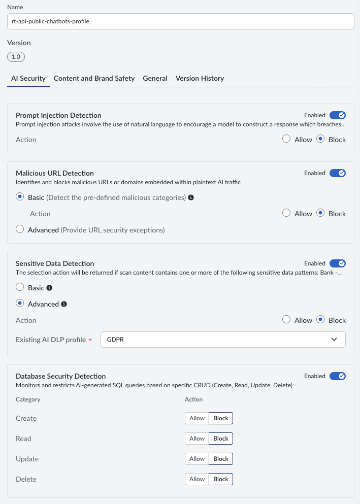
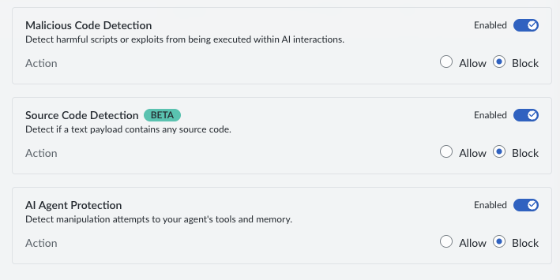
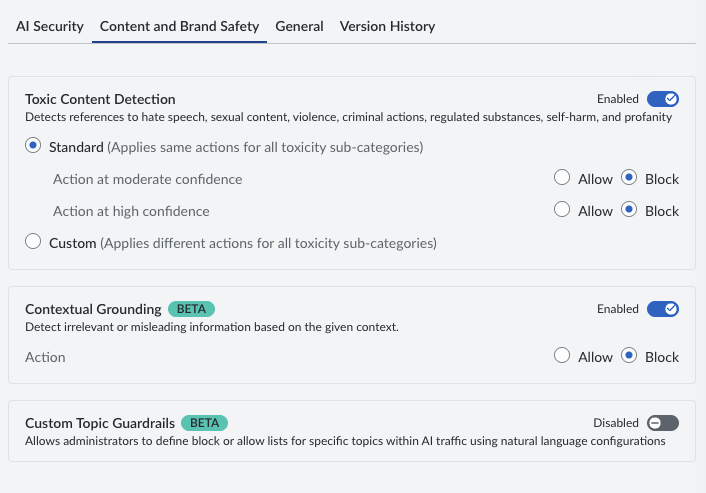

# 04. Prisma AIRS - AI Runtime Security (AI Runtime API & AI Runtime Firewall)

## Introduction

The **Prisma AIRS AI Runtime Security** module delivers end-to-end, real-time threat prevention, data privacy compliance, and inline security posture for artificial intelligence workloads. It encompasses two core enforcement vectors designed to protect GenAI applications across multi-cloud environments (Azure OpenAI, AWS Bedrock, GCP Vertex AI, ...):

1. **AI Runtime API (Application & Gateway Integration):** Provides high-performance, low-latency API-level inline payload inspection, Prompt Injection prevention, and Enterprise DLP directly within application backend routes and AI Gateways. *(Implemented in Phase 1)*
2. **AI Runtime Firewall (Network & L4-L7 Perimeter Enforcement):** Provides deep network-level inspection, VPC/VNet transit protection, and L4-L7 traffic controls for enterprise AI pipelines, model training environments, and egress traffic. *(Configured in Phase 2)*

This module (`04-AI-Runtime`) serves as the single unified architecture hub for **both** the **AI Runtime API** and the **AI Runtime Firewall (FW)** under **Palo Alto Networks Strata Cloud Manager (SCM)**.

> 📘 **Official Documentation Reference:**  
> [Palo Alto Networks - Configure AI Runtime Security Administration Guide](https://docs.paloaltonetworks.com/ai-runtime-security/administration)

---

## 🏛️ Module Architecture: Dual Protection Pillars

| Protection Pillar | Scope & Placement | Enforcement Layer | Primary Capabilities |
| :--- | :--- | :--- | :--- |
| **AI Runtime API** | Application Code, Next.js Middleware, AI Gateway Hooks | L7 Payload / REST API | Prompt Injection blocking, Jailbreak detection, Modulo 23 DNI DLP, $0.00 Upstream FinOps interception |
| **AI Runtime Firewall (FW)** | Cloud Perimeters (Azure VNet, AWS VPC, GCP VPC), Transit Hubs | L4–L7 Network Traffic | Inline packet inspection, malicious IP/URL filtering, outbound exfiltration blocking, A2A network isolation |

---

## Step-by-Step Deployment Guide: Phase 1 — AI Runtime API

### 1. Licensing and Activation (FinOps & SecOps Alignment)

AI Runtime Security inspection (API and Firewall) is metered using **Palo Alto Networks Flex Credits**. 

From a **FinOps** perspective across Azure, AWS, and GCP, executing inline inspection at the runtime layer prevents malicious actors from exhausting model quotas (Tokens-Per-Minute / Requests-Per-Minute) or triggering runaway inference costs ("Denial of Wallet" attacks).

* **Token Metering Baseline:** $1 \text{ token} \approx 4 \text{ characters}$ of text (industry standard).
* **Sizing:** License your tenant according to the expected monthly inspection volume across API payloads and firewall traffic transit.

#### Activation Steps

* Create a **Deployment Profile (DP)** in Strata Cloud Manager (SCM) and allocate Flex Credits to AI Runtime Security (API).
* Map the Deployment Profile to a **Tenant Service Group (TSG)**.  
  > ⚠️ The Tenant Service Group (TSG) **MUST be located in the Americas Region**.
* Launch SCM to complete setup and configuration.

> 📘 **Official Documentation Reference:**  
> [Palo Alto Networks - Create a Deployment Profile for Prisma AIRS AI Runtime API](https://docs.paloaltonetworks.com/ai-runtime-security/activation-and-onboarding/ai-runtime-security-api-intercept-overview/ai-deployment-profile-airs-api-intercept)
---

### 2. AI Security Profile Configuration in SCM

AI Security Profiles define the unified security policies, threat signatures, and DLP rules enforced by both the **AI Runtime API** and the **AI Runtime Firewall**.

#### Step 1: Create the Security Profile

1. Access **Strata Cloud Manager** ([stratacloudmanager.paloaltonetworks.com](https://stratacloudmanager.paloaltonetworks.com/)).
2. Navigate to **AI Security** -> **AI Runtime** -> **Configurations**.
3. Click **Create New** and configure:
   * **Profile Name:** `rt-api-public-chatbots-profile`
   * Under **AI Security:**
   

   
   

   

   
   

   * Under **Content and Brand Safety:**
   

   
   

   * **Remaining options**: default

#### Step 2: Create the Application