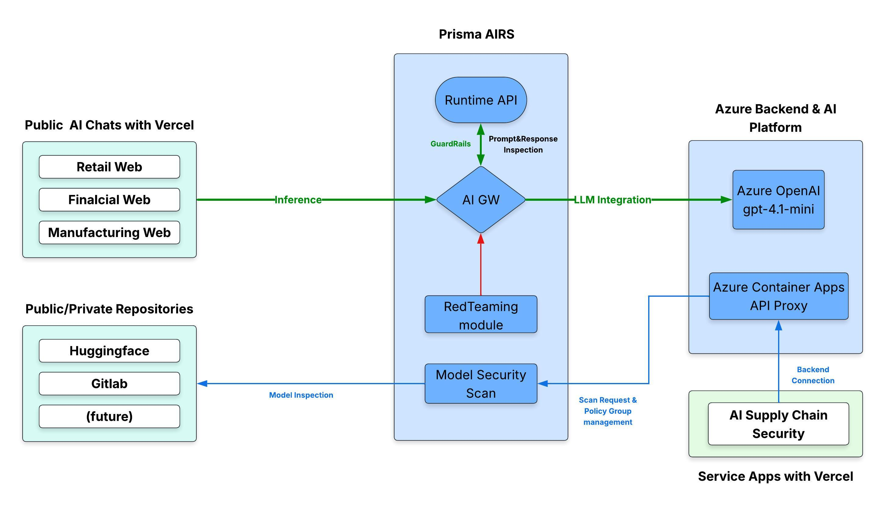
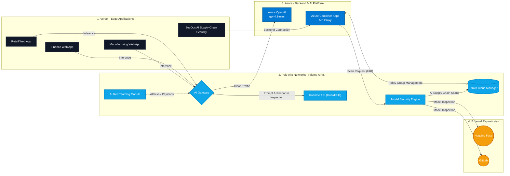

# Prisma AIRS & Azure OpenAI Demo Environment

An automated, enterprise-grade Infrastructure-as-Code (IaC) package using **Terraform** to deploy a serverless Azure AI environment.

Purpose-built for demonstrating **Palo Alto Networks Prisma AIRS** capabilities like **AI Gateway**, **AI Runtime Security**, **AI Supply Chain Security**, **AI RedTeaming**, ...

---

## Architecture

* **Azure OpenAI Service**: Deploys `gpt-4.1-mini`.
* **Azure Storage Account (`Standard_LRS`)**: Dedicated Blob Storage container for AI model vulnerability scanning (`.pkl`, `.safetensors`, `.onnx` files) via **Prisma Model Security**.

---

## Deployment Workflow

To successfully deploy and secure this environment, follow this two-phase execution path:

### Phase 1: Deploy Azure Infrastructure
Before configuring any security policies, you MUST provision the base cloud resources in Azure.

👉 Go to [Azure Infrastructure Deployment Guide](./01-azure-openai-infrastructure/)

### Phase 2: Enable Prisma AIRS Security Modules
Once your Azure OpenAI endpoint and Storage Account are active, explore and implement the security integration modules based on your use case:

| Security Module | Description & Focus Area | Direct Folder Link |
|---|---|---|
| **01. AI Gateway** | Governs all LLM, MCP, and agent-to-agent (A2A) interactions across multi-cloud environments. | [01-AI-Gateway](./02-Prisma-AIRS/01-AI-Gateway/) |
| **02. AI Supply Chain Security** | Decodes model architectures, weights, and operators to expose hidden backdoors. Automatically inspects codebase repositories to catch insecure configurations, permissions, and vulnerabilities in model files and skills.. | [02-AI Supply Chain Security](./02-Prisma-AIRS/02-AI%20Supply%20Chain%20Security/) |
| **03. AI RedTeaming** | Simulates context-aware, automated attack scenarios to discover emergent behaviors and flaws in hours instead of weeks. | [03-AI RedTeaming](./02-Prisma-AIRS/03-AI%20RedTeaming/) |
| **04. AI Runtime** | Intercepts and blocks prompt injections, indirect injections, and data exfiltration across prompts, tool calls, and LLM outputs. | [04-AI Runtime](./02-Prisma-AIRS/04-AI%20Runtime/) |

### Phase 3: Deploy Demo Applications (AI Consumers)
Launch pre-configured frontend applications to simulate real-world AI traffic (e.g., retail chatbots) and demonstrate the applied Prisma AIRS security policies and FinOps controls in action.

👉 Go to [AI Application Layer](./03-AI-Apps/)

## Prerequisites

Before running this deployment, ensure you have:

1. **Azure CLI**: Installed and logged in (`az login`).
2. **Terraform**: Version `>= 1.5.0` installed.
3. **Node.js & npm**: `Node.js v18+` (Required for running the Prisma AIRS CLI abstraction).
4. **Prisma AIRS CLI**: Official operational CLI tool (`@cdot65/prisma-airs-cli`) that provides full operational coverage over Palo Alto Networks Prisma AIRS AI security capabilities.
   * **Installation Guide**: [Prisma AIRS CLI Installation](https://cdot65.github.io/prisma-airs-cli/getting-started/installation)
   * **Quick Install**: `npm install -g @cdot65/prisma-airs-cli`
   * **Verification**: Run `airs --version` in your terminal to verify installation.
5. **Git**: Installed and configured with your credentials.
6. **Active Azure Subscription**: Permissions to create Resource Groups, Cognitive Services, and Storage Accounts.
7. **Palo Alto Networks FlexCredits**: Active **FlexCredits** allocated in your Customer Service Portal (CSP) / Strata Cloud Manager (SCM) tenant to enable and consume Prisma AIRS modules (AI Gateway, AI Runtime Security, Model Security, etc.).
8. **Vercel Account (Free/Hobby Tier)**: Required to deploy the Next.js frontend demo applications (Phase 3). Vercel's Edge infrastructure acts as the serverless host for our UI, securely proxying traffic to the Prisma AIRS Gateway without incurring additional cloud compute costs.